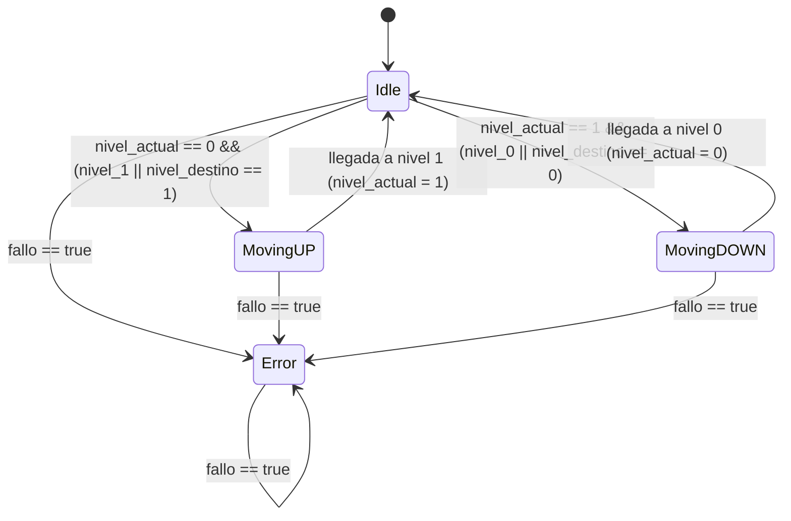
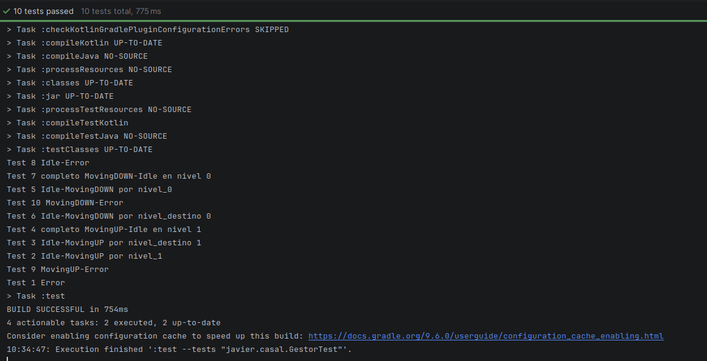

# Solucion: Maquina de Estados del "ASCENSOR-HALO CASAL"

---

## 1. Diagrama de Estados

---

## 2. Variables del Sistema
* `nivel_actual` (`Int`): Almacena el nivel en el que se encuentra el ascensor (`0`: Av. García Barbón, `1`: Pza. Compostela, `2`: En movimiento, `-1`: Error). Iniciado dn `0`
* `estado_actual` (`Estados`): Controla el estado de la máquina en ese momento(`Idle`, `MovingUP`, `MovingDOWN`, `Error`) 
* `nivel_destino` (`Int`): Indica el nivel/planta al que se quiere ir
* `fallo` (`Boolean`): Indicador de si se ha producido un error en el sistema
* `nivel_0` (`Boolean`): Boton del ascensor para seleccionar la nivel/planta 0
* `nivel_1` (`Boolean`): Boton del ascensor para seleccionar la nivel/planta 1

---

## 3. Funcionamiento del programa

* `gestor()`: Actua como el centro de la maquina de estados, evalua el `estado_actual` mediante un bloque `when` y dirige la ejecución, devolviendo el `nivel_actual` actualizado
* `gestionarIdle()`: Comprueba si existe error (`fallo`) o si se ha pulsado algún boton del ascensor (`nivel_0`, `nivel_1`) para inciar los estados de movimiento (`MovingUP` o `MovingDOWN`)
* `gestionarMovingUp()`: Simula el ascenso estableciendo y completando la llegada al nivel `1` bajo el estado `Idle`
* `gestionarMovingDown()`: Simula el descenso estableciendo y completando la llegada al nivel `0` bajo el estado `Idle`
* `gestionarError()`: Bloquea de el sistema, estableciendo el estado en `Error` y el nivel actual a `-1`

---

## 4. Casos Test

